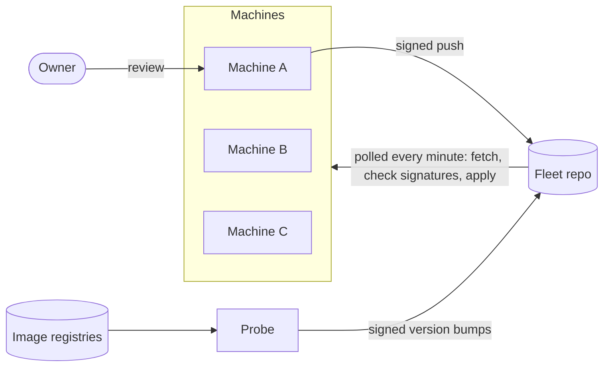

# Mothership

Mothership installs a set of machines from one git repo, the fleet, and keeps each machine matching it. When a machine drifts from the fleet, mothership shows the owner what changed, and the owner decides which side is right.

## Requirements

1. A dead machine comes back with one install command, the owner's logins and a data restore.
2. The fleet holds the truth: a push reaches every machine it concerns, without logging in to each.
3. Nothing changes on a machine unseen: every difference from the fleet shows up, and the owner settles each one.
4. A push alone never reaches root, so a stolen git login or an AI agent that can push can't take a machine.
5. Secrets live in the fleet, encrypted, and each machine and user opens only its own.
6. A user without sudo can't reach root through mothership.
7. Machines run containers with pinned versions, automatic minor updates and rollbacks.

## Concepts

- **Fleet**: the git repo that describes every machine.
- **Owner**: the person the fleet belongs to.
- **Device type**: a kind of machine the fleet describes. Every machine follows one type, and machines of the same type end up identical, such as `office-pc` or `db-server`.
- **Home**: a user's files in a type.
- **Apply**: mothership brings the fleet's changes to the machine.
- **Scan**: mothership lists how the machine differs from its type.
- **Review**: the owner settles each difference, either by changing the fleet to match the machine or the machine to match the fleet.
- **Signer**: a key that may sign fleet commits. Machines apply only signed commits.
- **Recovery key**: a key kept on paper that opens every secret and signs anything.
- **Service**: containers that work together, such as an app and its database.
- **Probe**: a job that follows new image versions and commits them to the fleet.

## How it fits together

## Features

| File                             | What it covers                                                  |
| -------------------------------- | --------------------------------------------------------------- |
| [FLEET](features/FLEET.md)       | What the repo holds: types, users, homes, hardware, options     |
| [INSTALL](features/INSTALL.md)   | Turning a blank machine into one that follows the fleet         |
| [SYNC](features/SYNC.md)         | Apply (repo to machine) and review (machine to repo)            |
| [TRUST](features/TRUST.md)       | Signatures, SSH keys, adding and retiring machines              |
| [SECRETS](features/SECRETS.md)   | Encrypted secrets and who opens them                            |
| [SERVICES](features/SERVICES.md) | Containers: ports, links, data, secrets, updates and rollbacks  |
| [PROBE](features/PROBE.md)       | Where images come from and how versions follow their publishers |

## Commands

All of them run with `sudo`, except `version`.

| Command | What it does |
|---|---|
| `install [options]` | Sets up this machine from the fleet. Each option answers one of its questions: `mothership install --help` lists them. |
| `apply` | Moves to the mothership release the fleet names, then brings the fleet's changes since the last apply, after showing the plan. It never undoes a change made on the machine. |
| `scan` | Lists how the machine differs from its type: what changed on the machine, what's coming from the fleet, and what needs attention. |
| `review` | Goes through the machine's changes one by one: **add** it to the fleet, **revert** it, **ignore** it, or **pass** on it until the next review. Nothing changes until its last question: it then commits and pushes the answers, signed, and reverts. |
| `commit <message>` | Signs and pushes your own edits in the fleet's folder. It lists the files they change, so you read the edits in a git app first. |
| `trust <host> <type> [--option <option>]... <name>=<key>...` | Writes a machine's file in `machines/` with its keys, encrypts again the secrets those keys open, adds the keys to GitHub, and prints the code to type on that machine. |
| `retire <host>` | Deletes a machine's file, removes its keys from GitHub, and lists the secrets you should change. |
| `secret <service> <name>` | Reads a value and encrypts it into the service's secrets, for the type's root keys and the recovery key. `<service>` may be `<type>/<service>`. |
| `recovery` | Asks for the fleet's recovery key, replaces it and encrypts every secret again. |
| `version` | Prints mothership's version. |

## Choices

- **Each distribution's own package manager, with chezmoi for homes.** Mothership adds what chezmoi lacks: types, the flows between the repo and the machines, secrets and restores. NixOS does most of this natively, so moving to it later means translating the types.
