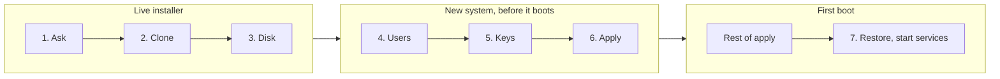
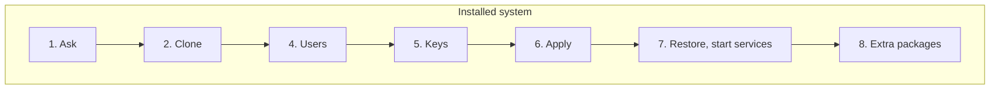
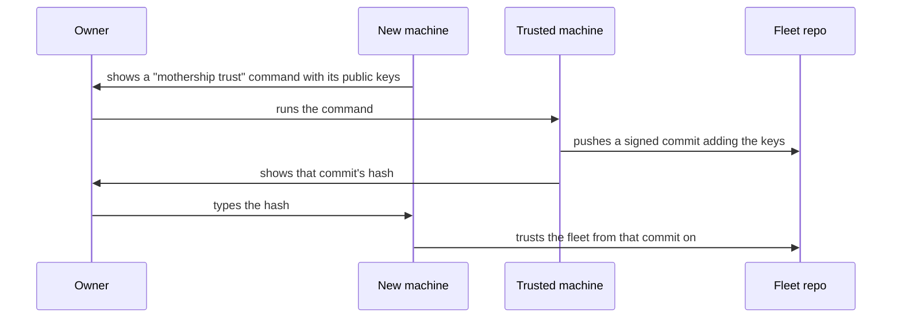

# Install

`mothership install` turns a blank machine into one that follows the fleet. Part of [MOTHERSHIP](../MOTHERSHIP.md).

## Requirements

1. One command turns a blank machine into one that follows the fleet. When it ends, scan reports nothing.
2. Install works on an empty disk, and on a machine whose system is already installed, such as a cloud provider's image.
3. Disk encryption is an option. With it, the TPM opens the disk only for the machine's own signed system, so a stolen disk or a foreign system reads nothing.
4. A new machine trusts the fleet only once a machine already trusted vouches for it, or the owner types the recovery key.
5. Running install again after a failure picks up where it stopped.

## Design

Install runs on one of two starting points:

- **A live installer**, booted from a USB stick (today the Arch ISO). Install prepares the disk and installs the system itself.
- **An installed system** (today Debian or Ubuntu), such as a cloud provider's image. The disk is already set up, so install skips that part.

### Steps

1. **Ask** the fleet's SSH URL, the hostname and which user will own the machine's clone of the fleet.
2. **Clone the fleet.** Install creates that user's SSH key, prints the command that registers it with the git host, and clones once the host lets it in. When the fleet already has a file for this hostname, as for a reinstall, install takes the type and options from it, and `trust` later replaces its keys. Otherwise it asks for them, and `trust` writes the new file ([FLEET](FLEET.md#machines)).
3. **Prepare the disk**, on a live installer only, and install the base system on it.
4. **Create the users** the type lists, and ask for the clone owner's password.
5. **Create the machine's keys** (age, SSH, signing) and get the fleet to trust them.
6. **Apply** the fleet, except the services whose data a backup tool saves: they stay stopped, so none starts empty and gets backed up empty.
7. **Restore the data** through a backup tool, then start those services.
8. **Remove extra packages**, on an installed system only: install lists the packages the type doesn't need and removes them once the owner agrees.

On a live installer, steps 1 to 3 run on the USB stick, and steps 4 to 6 run inside the new system before it ever boots. What needs a running system, such as user services, waits for the first boot, which finishes the install.

### The disk

Install lists the disks, and changes one only after the owner types its name. It offers two layouts:

- **wipe**: the system takes the whole disk;
- **beside**: the system goes in the largest free space, and the system already there, such as Windows, stays bootable.

With encryption, install encrypts the system's partition with a passphrase, and signs the boot image with keys of the machine's own for Secure Boot. At first boot, install checks Secure Boot is on, and from then on the TPM opens the disk by itself, as long as the machine boots its own signed system.

### Trust

The new machine can't apply the fleet until the fleet lists its keys, and only a signed commit can add them.

With no trusted machine at hand, the owner types the recovery key instead: install trusts the fleet from the newest commit on `main` the recovery key signed, and checks every commit after it like any machine does. It shows the commits it refuses and asks whether to vouch for them or drop them, then adds its own keys in a commit the recovery key signs. When the recovery key signed no commit, install says so and stops. On a new fleet, no machine signs yet, so install goes straight to the recovery key, and makes it when the fleet has none. Only such a fleet may get its recovery key at install, since machines that sign would refuse a commit signed by a key the fleet never named. When install makes the key, it first shows the fleet's newest commits, and once the owner accepts them, the commit that trusts the machine names the key in `mothership.toml`.

### Failures

Install saves its answers, and each step checks what's already done, so running it again redoes only what's left.

A new install doesn't bring back logins inside apps, browser profiles or work clones, and fingerprints are enrolled by hand.
