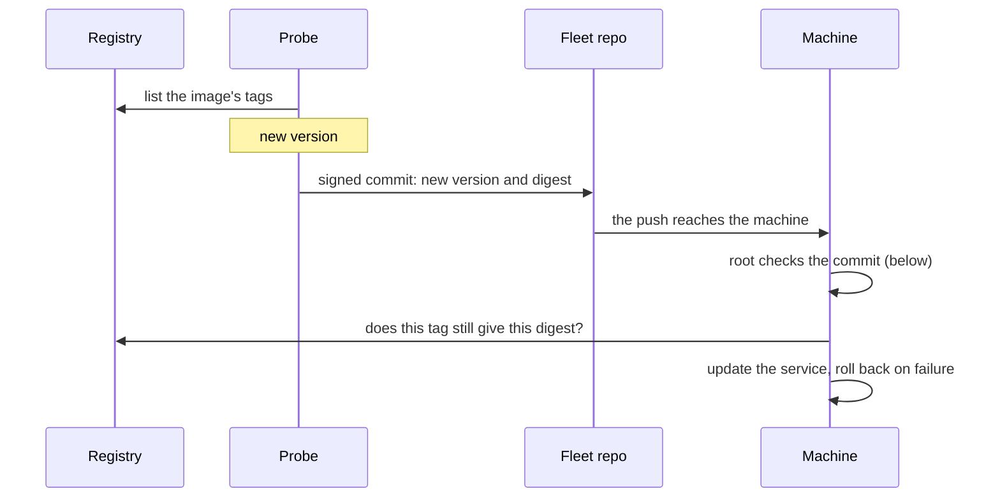

# Probe

The fleet pins every container image to exact bytes, so nothing a machine runs changes without a fleet commit. The probe writes those commits: it watches for new versions of each image and moves the pins forward. Part of [MOTHERSHIP](../MOTHERSHIP.md), for [SERVICES](SERVICES.md).

## Requirements

1. Each machine runs exactly the image bytes the fleet names.
2. Patches and minor versions arrive on their own. A new major waits for the owner.
3. A public release waits 2 days before machines run it, so a broken or hijacked release gets caught first. The owner's own images arrive as soon as CI publishes them.
4. A fix in a base image reaches the owner's images without a new release.
5. A stolen probe can only move versions forward: never add a service, or change a config, a port, a link or a secret.
6. No machine builds an image.
7. A small custom image needs no repo of its own.

## Design

### Pins

A service's `service.toml` pins each image with two values:

- the **version**, the tag people read, such as `17.12-alpine`;
- the **digest**, a fingerprint of the image's exact bytes, such as `sha256:…`. A tag can move to new bytes, a digest can't.

Versions follow the usual convention. From 16.4.2, 16.4.3 fixes bugs, 16.5 adds features, and 17, a new **major**, may break things. A version also has a **shape**: how many numbers it has and what follows them. `17.12-alpine` and `17.13-alpine` share a shape, while `17.13-bookworm` and `17` don't. Registries publish several shapes side by side, so the probe only follows the one the pin uses.

### Where images come from

- **A public registry**, such as Docker Hub.
- **One of the owner's repos**, which `service.toml` names. Its CI builds the image and publishes it.
- **A recipe**: a single Dockerfile, built without any other file, kept in the service's folder in the fleet, for a small image such as a public one with a plugin added. A workflow in the fleet repo builds and publishes it. Mothership writes that workflow and keeps it current. A recipe's version is the owner's own number, written in the Dockerfile.

### What the probe does

The probe runs on one machine, the one `mothership.toml` names, as a system service with a temporary user of its own. It checks the owner's images every 5 minutes and public images every hour. For each pinned image:

1. It lists the image's tags in its registry.
2. It picks the newest version with the pin's major and shape. A public version must be at least 2 days old.
3. If that version is newer than the pin, or is the same version with a new digest (publishers do that to ship system fixes), it writes the new version and digest into `service.toml`.
4. If a newer major exists, it notifies the owner and changes nothing.

It signs its changes in one commit and pushes it. Machines then apply it like any other fleet change ([SYNC](SYNC.md)).

The probe commits on top of the fleet's `main`. It first checks every commit since the last one its machine accepted, as root would, and waits while one of them would be refused.

### Fixes in base images

The owner's images are built on top of base images, such as `FROM alpine:3.20`. When the base image gets new bytes, for a security fix for example, the owner's image still holds the old ones.

So the probe also watches the base images each Dockerfile names. When one changes, it asks that repo's CI to rebuild the current version, through a `rebuild` event (to the fleet repo, for a recipe). The rebuilt image keeps its version and gets a new digest, which the probe pins as in step 3.

A recipe image records the fleet commit it was built from. The probe pins it only when root accepted that commit, so an unsigned Dockerfile never reaches a machine.

### What root checks

The probe's key could be stolen, so its signer may change only versions and digests. A machine refuses a probe commit that changes anything else, changes a major or a shape, or goes to an older version.

The digest still comes from the probe, so before a machine first runs a pin the probe set, it asks the registry whether that tag gives that digest. A thief can't slip in other bytes under a real tag. A pin the owner commits skips this check: publishers sometimes move a tag to new bytes, and an old pin would then block every reinstall. When a tag moved during the 2-day wait, install asks the owner whether to run the pinned digest anyway.

### Credentials

| What                  | With                                                                     |
| --------------------- | ------------------------------------------------------------------------ |
| Pull private images   | a token that can only read packages, a secret of each type that needs it |
| Push the fleet        | the probe's own deploy key, which writes to the fleet repo only          |
| Send `rebuild` events | a git host token that may send them, kept with the probe's keys          |
| Sign its commits      | the probe's own signing key, limited to versions ([TRUST](TRUST.md))     |

The probe's keys are created on its machine and never enter the fleet.

### The owner's images

A repo whose image the fleet runs releases this way:

- A version tag (`v1.9.2` or `1.9.2`) makes a release. CI builds and publishes the image, and rebuilds the current version on a `rebuild` event.
- The Dockerfile sits at the repo's root and names base images by version, never by digest, so a rebuild picks up their fixes.
- The app has a health check that answers only when it can serve requests.
- The app migrates its data when it starts, so a patch or a minor never needs a hand step.
- The app reads its secrets from files.

## Choices

- **Images without versions are refused.** Root couldn't check what the probe gives them. Such an image gets rebuilt with versions of its own, from a recipe or a repo.
