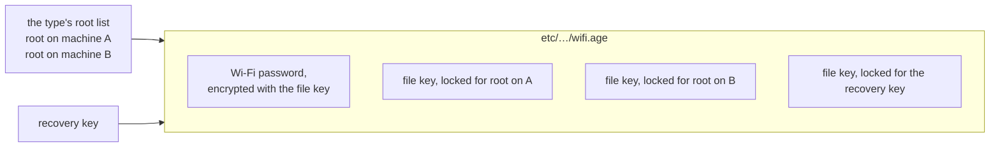

# Secrets

A secret is anything that gives access when read: a private key, a password, a token. The fleet holds secrets encrypted, so the repo can sit on a git host, and each machine decrypts only the ones it needs. Part of [MOTHERSHIP](../MOTHERSHIP.md).

## Requirements

1. No secret sits in the fleet in clear.
2. Each machine and user opens only what it needs: a server doesn't open a user's SSH key, and a user without sudo doesn't open root's secrets.
3. Losing one machine never blocks another of its type, and the recovery key opens everything.
4. A secret written on disk is readable by its owner only.
5. Scan finds new secrets, and they go into the fleet encrypted.
6. Retiring a machine lists every secret it could open, so the owner can change them.

## Design

### Keys and lists

Secrets are encrypted with age. An age key has two halves: the private half opens secrets and never leaves its machine, and the public half encrypts them and sits in the fleet. A secret encrypted for several public halves opens with any of the matching private ones.

Each machine creates one key for root, `/etc/mothership/key.txt`, and one for each user, `~/.config/mothership/key.txt`. Mothership builds two kinds of lists of public halves from the machines' files ([FLEET](FLEET.md#machines)):

| List               | Holds the key of                       | Opens                                         |
| ------------------ | -------------------------------------- | --------------------------------------------- |
| a type's root list | root, on each machine of the type      | the type's `/etc` secrets and its containers' |
| a user's list      | that user, on each machine of the type | that user's secrets                           |

A machine that may sign a folder also opens its secrets, with its root key: one that signs everything opens every secret, so `trust` and `secret` can encrypt them again from it. Every secret is also encrypted for the recovery key, whose public half sits in `mothership.toml`.

When mothership takes in a commit, it writes each user's list to `/var/lib/mothership/recipients/<type>/<user>.txt`, where the user's chezmoi reads it to encrypt.

age encrypts a secret's content once, with a random file key, and stores one copy of that file key locked for each reader. A reader opens their own copy with their private half, then the content. So the list decides who gets a copy:

Giving a new reader a copy means opening the file key first, so only a reader can add another.

### Two forms of secret

- **A whole file**, such as an SSH key or a network connection. It sits encrypted where the file belongs: as a `.age` file under the type's `etc/`, or in a home with chezmoi's `encrypted_` prefix. Apply writes it decrypted, readable by its owner only.
- **A value inside a config file**, such as an API key in an app's settings. The value sits in a `.secrets/` folder, put there by review, or by `mothership secret` for a service, and the config file is a template that inserts it when apply writes the file.

A secret several homes or types need sits once in `shared/.secrets/`, and each place that needs it links to it. It's encrypted for every list that links it. A new link opens nothing by itself: the next command that encrypts the secret again asks before adding the new list.

### Apply and scan

Root decrypts `/etc` and container secrets with its own key, and each user's chezmoi decrypts that user's home with the user's key. A secret the machine can't open yet is skipped and listed. Scan compares the decrypted version, so a changed secret shows up like any other difference.

### Finding new secrets

Scan guesses a new file is a secret when other users can't read it, or when it sits in a folder they can't enter. Review then offers to add it encrypted first, and in clear second. Adding a file in clear settles it: scan doesn't guess again from its permissions.

Permissions miss a token an app writes into a file anyone can read, or into one the fleet already tracks in clear. So scan also reads each file it shows for what a secret looks like: a private key, an age key, or a common API token such as GitHub's. Review then offers that file only encrypted, and when the fleet held it in clear, reminds the owner to change the secret, since git history keeps the old version. Review can also mark any other file **secret**.

### Machines joining and leaving

Giving a new key a copy of a secret means decrypting it first, so `trust` runs on a machine whose keys are already in the lists it touches. A machine that signs everything has its root key in every list. Without such a machine, a new machine installs with the recovery key, which opens everything ([TRUST](TRUST.md#the-recovery-key)).

- **A new machine** shows its public halves, and `trust` adds them to the lists and encrypts the lists' secrets again ([TRUST](TRUST.md)). Until then, its apply skips the secrets.
- **A retired machine** loses its keys from every list, and `retire` lists every secret the machine could open. `retire` doesn't encrypt them again: git history keeps the versions the machine's key opens, and the machine may keep copies, so only a new value protects a secret. The owner changes each one, and mothership encrypts the new value for the lists as they are, without the retired key. Since `retire` decrypts nothing, any machine that signs for the fleet can run it, even after losing the only machine in every list.

Logins inside apps stay out of the fleet: the owner logs in again after a rebuild.
