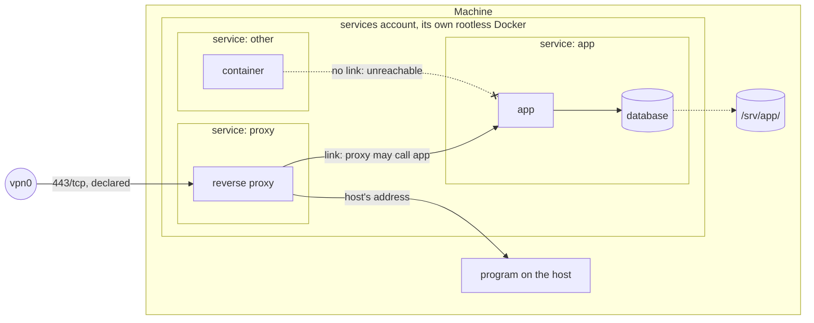

# Services

A service is a set of containers that work together, such as an app and its database. The fleet says which services each machine runs, apply makes it true, and scan reports any difference. Part of [MOTHERSHIP](../MOTHERSHIP.md). Where images and their versions come from: [PROBE](PROBE.md).

## Requirements

1. The fleet records exactly what runs, so a rebuild brings back the same containers.
2. A container that breaks out gets no more than the files of the account running the services, never root.
3. A service listens only on the ports the fleet declares, each on the network the fleet names, such as a VPN interface alone. On a port under 1024, a user without sudo can't take its place while it's stopped.
4. A service calls another service only when the fleet allows it.
5. A container reaches programs on its own machine and on other machines, such as a proxy forwarding to a backend elsewhere.
6. Each service keeps its data in one place, outside Docker, so backups, scan and install find it.
7. Outside the fleet, a secret is readable only by root and the `services` account: never by another account, and never in a log mothership writes.
8. A failed update puts the service back as it ran before, data included.

## Design

### A service in the fleet

Each service is a folder, `types/<type>/services/<name>/`:

- `service.toml`: each container's image, pinned to a version and digest ([PROBE](PROBE.md)), its ports and the services that may call it;
- `compose.yaml`: the containers as Docker Compose describes them, minus what `service.toml` owns (images, ports) and anything that would let a container escape its service (below);
- config files, some of them templates that insert secrets;
- `secrets/`: the service's encrypted secrets;
- a `Dockerfile`, when the image is a recipe kept in the fleet ([PROBE](PROBE.md)).

Apply accepts only the `compose.yaml` keys it knows, so a key a newer Compose adds stays refused until mothership checks it. It reads them before Docker does, because Compose reads the files that `include`, `extends`, `env_file` and `label_file` name as `services`, which can read every service's secrets. So it refuses `include`, `extends` and `label_file`, and an `env_file` or a secret outside the service's folder.

Apply also refuses a `compose.yaml` that reaches outside its service: a network mode, an external network, another container's namespaces, another container's volumes, Docker volumes, or files outside the service's folder and `/srv/<name>/`. It also refuses `privileged`, added capabilities and any `security_opt` other than `no-new-privileges`: each one exposes more of the kernel to the container, and a breakout most often needs a kernel bug. Devices stay allowed, such as a GPU for video, since rootless Docker only passes a device the `services` account can open itself.

### Who runs them

One account, `services`, runs every service of a machine with its own rootless Docker. It can't log in and has no home in the fleet. A container that breaks out lands in that account, not root. Users with sudo run nothing that faces the network, and a user who needs containers of their own, such as an agents' account, keeps their own rootless Docker.

One Docker runs every service, so a container that breaks out through a bug in Docker itself reaches every service of its machine, their data and secrets included. Separating them would take one Docker per service, and links that cross from one Docker to another. That's a high price for a rare bug that gets fixed quickly. Breaking out on one machine never reaches another.

### Ports

Each port names the network it listens on:

- `public`: every address of the machine;
- `local`: the machine itself only;
- an interface, such as `vpn0`: that interface's addresses only. Mothership knows no VPN: the fleet names the interface.

A port and protocol, such as `53/udp`, is declared once per machine, whatever its network. Rootless Docker can't see the machine's addresses: it forwards every published port to one address of its own, so the same port on two networks would land in the same place.

The system enforces the ports: `services`' Docker can open the declared ports and no others, even when a broken-out container asks it. It doesn't enforce the networks: Docker may open a declared port on any address, so the network each port faces holds as long as Docker does what mothership asks. It may also open ports under 1024, which users without sudo can't, so none of them can take a service's place on such a port while it's stopped. A port from 1024 up has no such guard.

A service facing an interface without an address yet, such as a VPN still connecting, waits. Apply records the versions it should run, and scan shows it under "Needs attention" until the address comes. Mothership then starts it without an apply, after any mothership command running then: a first start, or an update with its snapshot, health watch and rollback. It runs only what apply recorded: if the fleet changed since, the service waits for the next apply. When the address changes later, scan shows it and apply moves the service there.

### Links

A container lists the containers of other services allowed to call it, as `<service>/<container>`, such as `callers = ["gateway/caddy"]`. For each such pair, mothership creates a network holding only those two containers, where the caller reaches the called one as `<container>.<service>`. Every other container, the caller's database included, stays off that network.

A link works both ways: the called container can also reach the caller container. The caller is usually a proxy, which publishes its ports anyway.

Containers also reach their own machine's addresses and other machines, as any program does.

### Secrets

A service's secrets sit in its `secrets/` folder, each one a named value, encrypted for root on each machine of the type and for the recovery key ([SECRETS](SECRETS.md)). `mothership secret <service> <name>` adds one. Apply writes them decrypted into the service's folder, which only `services` reads.

A container gets its secrets in one of three ways:

- inside a config file, through a template that writes `{{ secret "name" }}`;
- as a file, `/run/secrets/<name>`, which the app reads;
- as an environment variable, `SECRET_<NAME>`, for an image that can't read files. `docker inspect` shows it to anyone who runs the services' Docker, so a file is better.

### Data

Each service keeps its data in `/srv/<name>/`, which mothership creates before the service first starts. No Docker command can touch it.

Copying that folder while the service runs can give a broken copy. A database spreads each change over several files and writes them one after the other, so a copy taken in the middle holds half a change, and the database may refuse to open it. Two ways give a copy that works:

- **Stop the service first.** Updates do this: the service is already stopped when its snapshot is taken (below).
- **Ask the database for a dump**, such as `pg_dump` or SQLite's `.backup`. The database writes a consistent copy while it keeps running.

Backups can't stop every service each night, so each service declares two commands: one that writes a dump of its data, and one that restores it. A backup service saves the dump, and install restores it before the service first starts. Files that aren't a database, such as photos, are copied as they are.

### Apply and scan

Apply writes each service into a folder only `services` reads, checks it, and starts it. It undoes only what it applied:

- a dropped service: apply stops it and removes its containers, networks and files, but keeps `/srv/<name>/`;
- the last service of a machine: apply also removes the `services` account and what it set up;
- a service file edited on the machine: apply leaves it alone and reports it.

Scan reports containers no service describes, edited service files, images that differ from their pin, link networks no link declares, and folders in `/srv` no service owns. Under "Needs attention", it shows services that are rolled back, refused or waiting. A stopped service shows under "Coming from the fleet", since apply starts it. Apply exits with an error while a service has a problem.

### Updates and rollbacks

An update stops the old version, copies the data aside (a snapshot) and starts the new version. It then watches the service for at least 30 seconds: a container that crashes or restarts fails the update, and the update succeeds once every health check passes, within 10 minutes. Once the update ends, apply deletes the snapshot. A service with bulky data that updates never change, such as a photo library, names the part to copy, usually its database. An update copies the parts either version names, so the rollback puts back whatever the old version counted on.

If anything fails once the old version has stopped, the machine puts the service back exactly as it ran: versions, files and the snapshot.

Apply records an update before it stops the old version. When apply stops in the middle, such as on a reboot or Ctrl-C, or the rollback itself fails, the next apply puts the service back from the files and the snapshot the update kept, and counts the new versions as failed. Until then, the machine doesn't start the service at boot, and scan shows it under "Coming from the fleet". It doesn't try the failed version again while the fleet still asks for it, so the service never runs a mix of old and new versions nobody tested together. The rollback shows under "Needs attention" until the fleet changes.