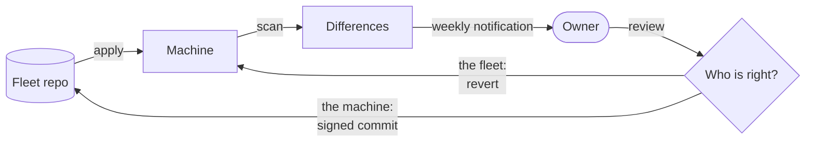

# Sync

Changes flow both ways between the fleet and each machine. Apply brings the fleet's changes to the machine. Scan and review bring the machine's changes back to the fleet, or undo them. Part of [MOTHERSHIP](../MOTHERSHIP.md).

## Requirements

1. A push reaches every online machine within a minute. A machine that was off catches up when it starts or its network comes back.
2. Apply never undoes a change made on the machine: it leaves it and says so.
3. A machine applies only signed commits ([TRUST](TRUST.md)), and stops when its `main` and the remote's have split.
4. Every week, each machine reports how it differs from its type, and the owner settles each difference.
5. Review changes nothing until the owner confirms all answers at once.
6. Review puts something in the fleet only when the fleet can rebuild it.

## Design

### Fleet to machine: apply

Each machine runs the mothership service as root, since installing packages needs it. It applies the fleet:

- every minute, when the remote's `main` has moved: the machine asks the git host for it, which costs one small request, and checks whether the change concerns it;
- when the machine starts, and when its network comes back, so a machine that missed a push catches up.

Apply fetches the fleet, checks the new commits' signatures ([TRUST](TRUST.md)), and moves the machine's `main` forward. When the machine's `main` and the remote's have split, it stops and says so. Without a network, apply and scan work from the last fleet the machine fetched.

It then brings the fleet's changes since its last apply: it installs what the fleet added, writes the files it changed, and removes what it dropped. Everything else stays as it is, so a package removed by hand stays removed, and shows under "Changed on this machine" until review settles it. The first apply brings everything. It doesn't upgrade packages: a type that wants automatic upgrades sets up its distribution's own tool for that.

A file edited on the machine and changed in the fleet is left alone, since apply can't tell which version is right. Review settles it, and the notification system says so.

### What scan shows

`mothership scan` compares the machine with its type, at any time, and sorts what it finds in three groups:

- **Changed on this machine**: differences review can settle (below);
- **Coming from the fleet**: what the next apply will do;
- **Needs attention**: what neither side can settle alone, such as a commit the machine refused, keys the fleet doesn't trust yet, or a service rolled back.

A machine can change in many places. Scan looks at:

- packages, including those from user repositories such as the AUR;
- tools installed outside the package manager: `bun` globals, `cargo install`, `uv tool`, AppImages, binaries in `~/.local/bin`;
- tracked files changed on the machine, `/etc` included;
- untracked config: new folders in `~/.config`, dotfiles in `~`, settings in `~/.local/share`;
- system and user services enabled or disabled;
- settings stored as data, such as dconf or a browser's preferences file;
- new secrets ([SECRETS](SECRETS.md));
- accounts the type doesn't list, and files in `shared/` no home links;
- containers no service describes, and data no service owns ([SERVICES](SERVICES.md)).

It leaves out the firmware, which it can't read, and new git clones.

### Machine to fleet: review

Review walks through each difference and asks who is right:

- **add**: the machine is right. The fleet takes its version, encrypted when it's a secret.
- **revert**: the fleet is right. The machine uninstalls the package or restores the file.
- **ignore**: neither matters. The type's ignore list gets it, for noise such as a cache folder.
- **pass**: the owner doesn't know yet. The next review asks again.

Review offers **add** only when the fleet can rebuild the item: a tool must come from a registry, a git branch, or an installer: a command the user lists that creates it. Otherwise it says why.

A package no repository has, such as a driver built from its own repo, is refused too. The owner lists it by hand in the type's `built_packages`, with a comment saying where it comes from. Apply never installs it, and scan says when a machine lacks it.

Nothing changes while the owner answers. At the end, review shows the commit and the reverts and asks once, so Ctrl-C or a no leaves everything as it was. On a machine that may only sign some folders, review refuses an answer that changes a file outside them, and the owner answers it from a machine that can.
