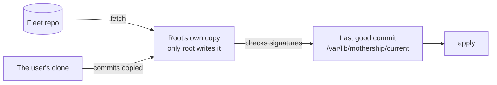

# Trust

Anyone who can push to the fleet's repo could change what every machine runs as root. Mothership doesn't trust the push: a machine applies a commit only when a key the fleet already trusts signed it. Part of [MOTHERSHIP](../MOTHERSHIP.md).

## Requirements

1. A push alone never reaches root, whoever pushed it.
2. A commit can't add the key that signs it.
3. A machine can be limited to signing its own type, so it can't change other machines.
4. With every machine lost, the recovery key still gets the owner back in.
5. A user without sudo can't make root apply something the fleet didn't sign.
6. Each user of each machine has their own SSH key, and retiring a machine removes them all.
7. A user lists who may log in to it over SSH.

## Design

### Signers

Each machine has a signing key that only root reads, `/etc/mothership/signing`. Its public half sits in the machine's file in `machines/`, with the folders it may sign ([FLEET](FLEET.md#machines)).

A machine applies a commit only when a key listed in the commit **before** it signed it. A commit that adds a signing key must then be signed by a key already listed, so nobody can sign themselves in. A commit that lists no signer and no recovery key leaves nothing to check the next one against, so that one needs no signature: this is how a new fleet starts.

Only `main` counts, along its main line: when a branch is merged, the machine checks the merge commit, not each commit of the branch. A signed merge vouches for everything it brings, so agents can work on branches without signing keys, and the owner merges what they did.

A refused commit on `main`, such as one nobody signed, stops every machine at the commit before it, and scan shows who pushed it and why the machine refused it. A later commit can vouch for it: the machine then checks the whole change since the last commit it accepted, against the signers that commit lists, as if one commit made it. Each command that signs, such as `commit`, lists the refused commits and the files they change first, with a link to compare them on GitHub when the fleet lives there, and asks whether to vouch for them, drop them from `main` and `origin`, or stop. A signer limited to some folders vouches only for changes inside them, and the probe never vouches, so it waits while a refused commit remains.

### Limited signers

A signer can be limited to some folders, such as `types/db-server`. It then signs only changes under them, and adds or drops only signers whose folders sit inside its own. So a machine limited to its type can't touch another type, and only a machine that signs everything can bring in a machine of another type. The probe's signer is limited to image versions, and its public half sits in the file of the machine that runs it ([PROBE](PROBE.md)).

### How a machine checks

One user with sudo owns the machine's clone of the fleet, `/var/lib/mothership/fleet`, and commits from it. That user, or any program running as them, controls the clone and its git settings, so root never runs anything from it:

Root copies the new commits into a repo only it writes, checks their signatures there, and applies the newest commit that passes.

### Signing commits

Commands that change the fleet sign and push their own commit, after showing it: review, `trust`, `retire` and `secret`. Hand edits go through `sudo mothership commit <message>`, which signs them the same way. Signing needs root, since only root reads the key.

### The recovery key

The recovery key is kept on paper. It signs anything and opens every secret ([SECRETS](SECRETS.md)). Its public halves sit in `mothership.toml`, never in a machine's file, so it works even when every machine is lost.

Install creates it on a new fleet's first machine, `mothership recovery` replaces it, and each prints it once. The paper holds a single age key, and mothership derives the signing key from it, so one written key does both.

### Mothership's own updates

`mothership.toml` pins the release of mothership every machine runs, with its checksum. A machine updates itself only to the release a signed `mothership.toml` names, so a push can't swap the binary either. Apply moves to that release first: on its own when it runs as the service, after asking when someone runs it by hand. A no stops apply, since the fleet's changes may need the new release.

### Adding and retiring machines

A new machine creates its keys during install and shows their public halves ([INSTALL](INSTALL.md#trust)). `trust`, run on a machine that signs:

1. asks which folders the new machine may sign, its type by default;
2. writes the machine's file with its keys;
3. encrypts again the secrets of each list the machine joins ([SECRETS](SECRETS.md));
4. signs and pushes that commit;
5. adds the keys to the owner's git host account: each user's SSH key for logins, the signing key so the host shows its commits as verified, and the probe's key as a deploy key of the fleet repo.

Apply creates any key the machine lacks later, such as a new user's, and scan shows the `trust` command until the fleet holds them.

`retire` deletes the machine's file, removes its SSH keys from the git host, and lists the secrets the machine could open ([SECRETS](SECRETS.md)).

### SSH and the git host

Each user of each machine has their own SSH key, `~/.ssh/id_ed25519`, so retiring one machine cuts only its own access. Any other login to the git host, such as a token for gh, is a secret like any other: in the home that uses it, or in `shared/` when several do ([SECRETS](SECRETS.md)). A user who logs in by hand keeps that login out of the fleet.

A user lists who may log in to it, such as `ssh_from = ["office-pc", "build-server/ci"]`: every user of a type, or one user of a type. Mothership gives their public keys to the home's templates, and the home writes its own `authorized_keys` from them, with any other keys it wants. A name the fleet lacks, or a list with no key left, stops mothership rather than writing an empty file that would lock everyone out. So `retire` refuses to remove a user's last key.

Before signing, each command that signs loads the changed fleet for every type and machine, and refuses a change that would stop any machine from loading it.

## Choices

- **Signatures checked by root, not the git host's branch protection.** Anything that can push, the git host included, stays outside what root trusts.
